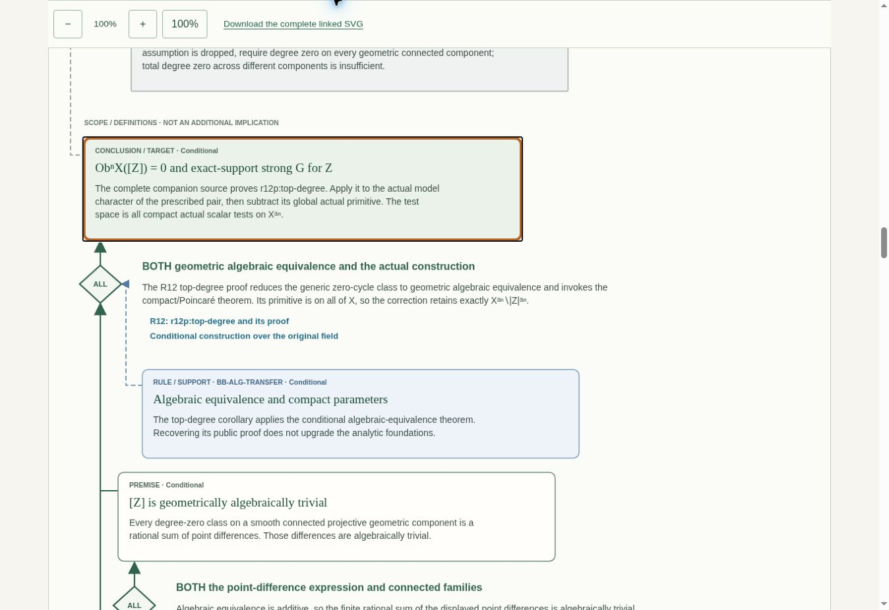

# Progress proof diagrams: source recovery and reading audit

Date: 18 November 2026. Mathematical source edition: **v0.5.1**, unchanged.
Remote base: `0b78691d01361dddf1ec4a59d8b4e88dbe49551a`.

This is a current-reading-view correction, not a new mathematical edition or
an acceptance of the analytic draft results. The 13 independent result pages
and all 32 application anchors remain in place.

## Recovered endpoint arguments

The first diagram publication reported that separate divisor and zero-cycle
proof bodies were not located in the inspected public corpus. That description
was too broad: the full public companion contains material omitted from the
shorter reading-paper adaptation. The original note is retained as the record
of the first pass; this note records its correction.

The recovered file is
`public/projects/strong-green/editions/v0.5.1/source-files/companion/proofs/foundations/R12_compact_parameter_algebraic_triviality.tex`,
SHA-256 `de1a3a130af7221532e3d860cc858ddea7b74e29316a3b854d7398512b9f0efe`.
Its `r12p:geometric-algebraic`, `r12p:picard-products`, and
`r12p:top-degree` give the relevant conditional construction and endpoint
specializations. The new graphs link the actual raw source and label the exact
locators rather than inventing anchors absent from the shorter paper.

For divisors, the graph spells out the algebraic bridge: geometric cycle-class
vanishing gives zero degree on every geometric integral curve, hence numerical
triviality; a nonzero tensor power is algebraically trivial, and rational
coefficients remove that multiple. The latter step is Kleiman, *The Picard
scheme*, Definition 6.1 and Theorem 6.3(b)⇒(a), printed p. 52, independently
checked in the [primary PDF](https://indico.ictp.it/event/a0255/session/66/contribution/39/material/0/0.pdf#page=52).
The existing R12 curve-lift source already cites this theorem.

For zero-cycles, degree vanishes on each geometric connected component, and
point differences are algebraically trivial. The direct top-degree companion
corollary treats actual model Chern polynomials. It is not extended to arbitrary
atomic actual forms or residual measures.

Both routes use the independent compact/Poincaré construction with the stated
`(A1)`, `(A2)`, and `(R)` inputs. They do not use the curve-transfer argument
which itself invokes the divisor endpoint. The comparison between different
model characters, original-field normalization, prescribed cycle support, and
all actual tests stay explicit. No `draft` or `conditional` record is promoted.

The point-slice nodes also restore the source's full carrier conditions:
normal, integral, quasiprojective, dimension `r`, finite inverse image of the
cycle support, and compact actual scalar tests.

## Reading and export corrections

- SVG content follows the visible top-to-bottom order in the DOM, including
  inference-source links, rather than placing all junctions after all nodes.
- Valid tree, node and junction fragments receive keyboard focus. Nodes without
  a primary link retain a visible target highlight.
- Scale controls have descriptive accessible names, remain visible while
  reading the long graph, and preserve the vertical and horizontal reading
  coordinate when the scale changes.
- Saved SVGs pin paper and permanent-record evidence to the mathematical
  source edition. Current proof-navigation links remain navigational, not
  evidence substitutions.
- All branches remain drawn with and without JavaScript. No replacement index,
  shortened proof summary, new feedback inbox, or additional reader write
  permission is introduced.

## Verification

Completed local checks:

- `npm ci` and the static build succeeded: 768 routes, 3 projects, 128 permanent
  entries. The 13 Progress families and all 32 application destinations remain
  covered.
- All **106** repository tests passed after the final rebuild. These include
  source and edition bindings, independent endpoint dependencies, DOM reading
  order, zoom position and hash-focus regressions, every source destination,
  download evidence pinning, and unchanged shared-feedback behavior.
- The complete Progress graph now has **108 trees, 810 scoped node occurrences,
  258 logical junctions and 1,173 connections**. Its SVG is 1120 by 218175 units.
  Node occurrences are not counts of independent accepted theorems.
- Inkscape's actual rendered bounding boxes were checked in all 14 Progress
  SVGs: 1,620 node occurrences and 516 junction occurrences, counting aggregate
  and separate copies. No overflow was found.
- Release integrity verified the 340 frozen Strong Green files, plus the
  existing two Bedford–Taylor editions, 853 files, 1,006 source bindings,
  24 PDFs and four ZIP inventories. No frozen mathematical input was edited.
- A second, independent source review found no circular endpoint dependency,
  missing full field degree, correction-sign change, or source-status promotion.
  Its request to make the shared tree's ambient hypotheses explicit was applied.

These checks verify source fidelity, graph coverage, publication consistency,
and reading behavior; they are not independent proof certification.

The cloud browser's DevTools are disabled by its organization. Device emulation
is therefore not part of this audit. An ordinary browser-zoom narrow CSS
viewport is checked separately and must not be described as a mobile-device
test.

## Observed production verification

Published code commit: `5ad8cee3d5382689fa6a7ad97c04f9091ea763b1`.
[GitHub Actions run 44309165415](https://github.com/DongKaicheng/math-research-atlas/actions/runs/44309165415)
completed successfully: both `build` and `deploy`, including the release and
history guards. A separate read-only check confirmed that the run's head and
the remote `main` head agreed with this commit before the evidence-only update.

The deployed browser pages were checked directly:

- The Progress diagram index reports 108 trees. The independent endpoint page
  contains all six trees, including the three recovered arguments.
- The divisor, zero-cycle and independent-construction fragment links resolve.
  Tree and conclusion fragments receive focus without opening their source.
- From the zero-cycle tree, native Tab navigation visits its componentwise
  scope, conclusion, R12 evidence and conditional-construction evidence in
  the visible reading order.
- The conditional-construction link opens the actual paper heading
  `9.1. Algebraic equivalence over the original field`; browser Back returns to
  the independent construction tree.
- Native pointer zoom from 110% to 120% preserved the visible centre's logical
  vertical coordinate to within 0.004 SVG units; keyboard activation of Reset
  preserved its pre-activation coordinate to within 0.008 SVG units. A
  locator-driven click performed an additional scroll before the click event,
  so that automation path was not used as evidence of native-pointer drift.
- Ordinary Chrome zoom at 300% gave a 454 CSS-pixel window and a 449-pixel
  document/body, with a 411-pixel graph viewport and the full 1120-pixel SVG.
  There was no horizontal body overflow. A native horizontal scroll moved the
  graph's `scrollLeft` from 0 to 189 without moving the body sideways. A tree
  destination remained below the wrapping sticky toolbar. Browser zoom was
  restored to 100% afterwards.
- The shared feedback URL retained the current project, source edition and
  exact graph fragment. No feedback was submitted and no new inbox was made.
- A real SVG download matched the local built asset byte for byte (SHA-256
  `6258acf4bdd004f363fbf2171c80ce87a9452db8a847de064d77b681f5c4947d`).
  Its six trees and 59 nodes are present; all 56 paper/record evidence links
  point to the frozen source edition.

The final browser was left at the linked zero-cycle conclusion. The following
unaltered screenshot records the deployed node-and-arrow view; the complete
tree continues vertically beyond this viewport.

Screenshot SHA-256:
`bda3ddc33ef664cb9518313aa93afd274d614b38265cd222d00dd9954acaa28c`.
